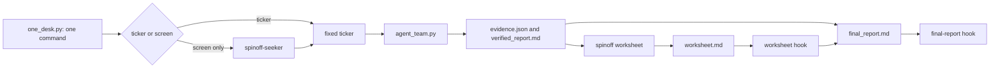

# Team Ledger — Abraham Blaesing, Brody Oliver, Gabriel DePalma

Client: an investor seeking absolute return. This is a course project, not investment advice.

## The desk

The joins: `one_desk.py` makes the fixed pipeline join. The seeker supplies a screened ticker
only when the command is `screen`. `agent_team.py` writes the evidence and verified report. The
worksheet adds a filing-grounded view to that report. The worksheet hook and final-report hook
guard the joined output. The Worksheet Investor may quote supplied worksheet facts and must not
calculate or recompute a number; see `roles/worksheet_investor.md`.

We own: the factor check in `lab06/factor-check-plan.md`. Its rules were fixed before results:
five equal-weight factors, an EDGAR-supported U.S. corporate-spinoff universe, the first official
close through day 180, and no imputation of missing material facts.

## Roles

- Abraham Blaesing: seeker code, official-close reader test, and live-report run/upload.
- Gabriel DePalma: filing checks for the Honeywell and BioStem examples.
- Brody Oliver: factor-file review, seeker-report review, and recomputation of one factor's
  points after the seeker produces a ranked candidate.

These roles are the team’s recorded starting assignments in `TEAM.md`. Update this section if the
team changed them in a commit.

## Lab 9 proof runs

Brody Oliver and Gabriel DePalma selected these two names. Both reports were produced by the
one-command desk, include the accepted earnings filing on the first line, and label spinoff facts
as not applicable.

| Ticker | Filing accepted time | Official pre-filing close | Verified final report |
|---|---|---|---|
| NVDA | Nov. 17, 2026, 4:20:51 PM Eastern | $150.96 on Nov. 17, 2026; LSEG Workspace `NVDA.O` Price History export | [report](https://github.com/ablaesin/FIN67110-AI-Research-Desk/blob/main/runs/nvda-20261119T134352Z/final_report.md) |
| CRWV | Nov. 10, 2026, 4:05:53 PM Eastern | $60.77 on Nov. 10, 2026; LSEG Workspace `CRWV.O` Price History export | [report](https://github.com/ablaesin/FIN67110-AI-Research-Desk/blob/main/runs/crwv-20261119T134549Z/final_report.md) |

## Live record so far

Repository path: [runs/live](https://github.com/ablaesin/FIN67110-AI-Research-Desk/tree/main/runs/live)

| Ticker | Release filing | Filing accepted time | Commit time | Inside the Week 5 window? |
|---|---|---|---|---|
| TDG | 8-K `0001260221-26-000073`, Exhibit 99.1 | Nov. 10, 2026, 6:32:12 AM Eastern | Nov. 17, 2026, 10:03:31 AM Eastern | No; the release is in Week 4, although the report was committed in Week 5. |

The Week 5 live-record window is Monday, Nov. 16 through Sunday, Nov. 22, 2026. Add the selected
Week 5 release here after it files. Record its filing-accepted time, the commit time, and whether
the commit is inside the window.
