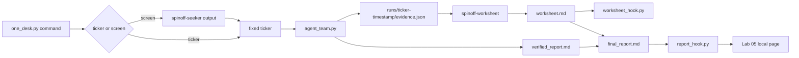

# One Desk Diagram

Digital diagram for the team review. It is not presented as a hand drawing.

Fixed order: seeker only for `screen`, pick, agent team, worksheet, worksheet hook,
final report, final-report hook. A model chooses none of these steps.

Files are `evidence.json`, `verified_report.md`, `worksheet.md`, and `final_report.md`.
Calls are the arrows that start a script or a model role.
